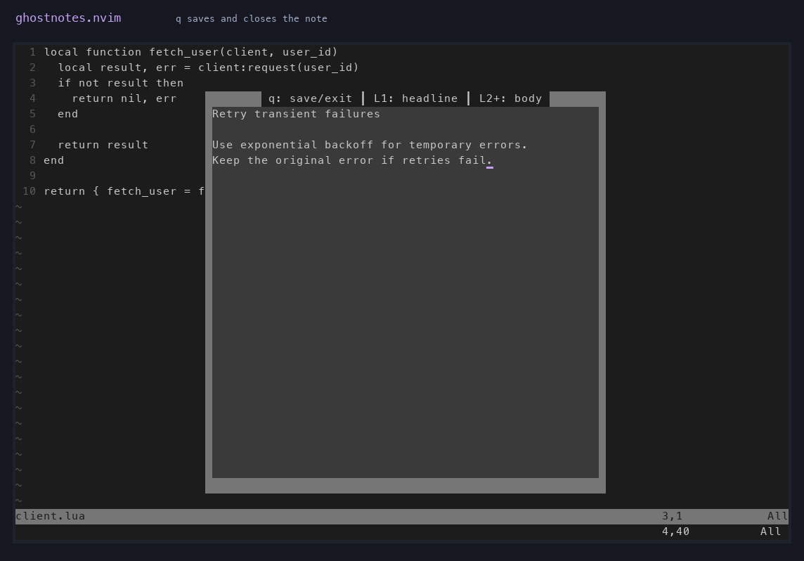
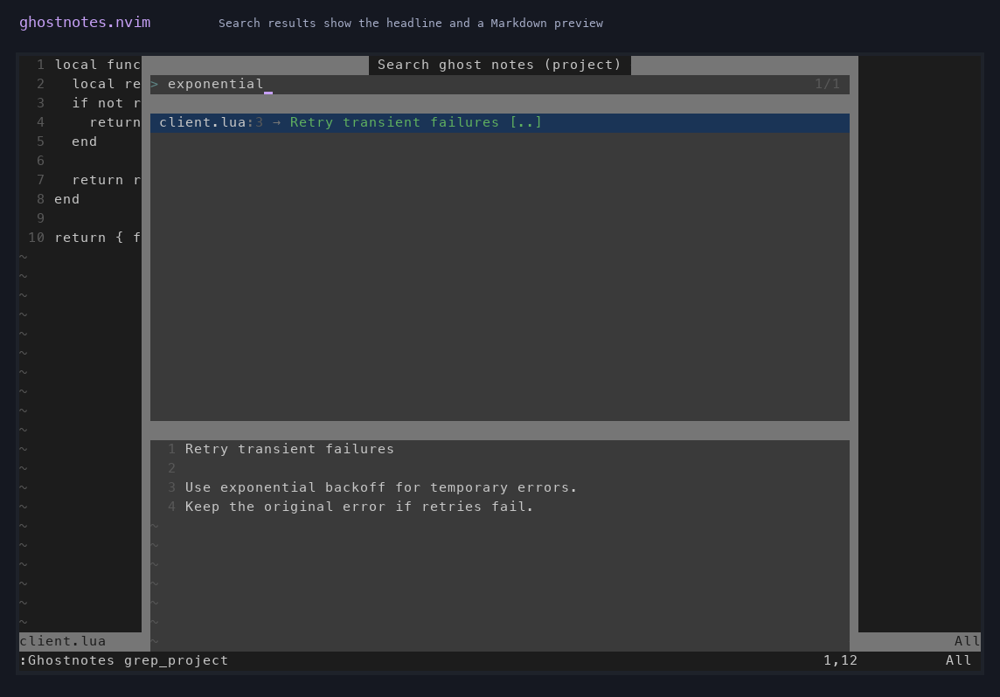

# ghostnotes.nvim

Keep Markdown notes on lines of code without changing the file. The first line
of a note appears as virtual text. Open the note to read or edit the rest.

Ghostnotes supports Neovim 0.10 or newer. Git is needed for project notes.
Snacks and Telescope are optional, and both support note previews and search.

## Install

With [lazy.nvim](https://github.com/folke/lazy.nvim):

```lua
{
  "vvilhelmsen/ghostnotes.nvim",
  opts = {},
}
```

Open a saved file, place the cursor on a line, and run `:Ghostnotes edit`.
Write a headline on the first line and an optional body below it. Press `q` to
save and close the note. Use `:Ghostnotes find` to find it again, or
`:Ghostnotes grep` to search its contents.

Run `:checkhealth ghostnotes` to check the note directory and picker setup.
See `:help ghostnotes` for the full reference.

## In action

The note editor and a project-wide body search, using Snacks and a custom
note prefix:





## Commands

| Command | Action |
| --- | --- |
| `:Ghostnotes edit` | Create or edit the note on the current line |
| `:Ghostnotes clear` | Delete the note and copy its text to register `g` |
| `:Ghostnotes yank` | Copy the note to register `g` |
| `:Ghostnotes paste` | Paste the note in register `g` onto the current line |
| `:Ghostnotes find` | Find notes from all files |
| `:Ghostnotes find_project` | Find notes in the current Git project |
| `:Ghostnotes grep` | Search note headlines and bodies globally |
| `:Ghostnotes grep_project` | Search note headlines and bodies in the current project |

Command names support tab completion. Find and grep show the headline in the
result list and the full note in the preview. Grep searches the whole note for
case-insensitive literal text, highlights matches, and scrolls to the first one.

By default, Ghostnotes uses Snacks if available, then Telescope, then
`vim.ui.select`. The fallback uses `vim.ui.input` for the same plain-text
search and does not show previews. Set `picker.provider` if
you want to choose a picker explicitly. A requested but unavailable provider
reports an error rather than silently choosing another.

## Keymaps

The existing mappings remain enabled for compatibility. The `keymaps` option
is deprecated; use the commands with your own mappings instead. To opt out of
all default mappings:

```lua
require("ghostnotes").setup({ keymaps = false })

vim.keymap.set("n", "<leader>gne", "<cmd>Ghostnotes edit<cr>", { desc = "Edit ghost note" })
vim.keymap.set("n", "<leader>gnc", "<cmd>Ghostnotes clear<cr>", { desc = "Clear ghost note" })
vim.keymap.set("n", "<leader>gny", "<cmd>Ghostnotes yank<cr>", { desc = "Yank ghost note" })
vim.keymap.set("n", "<leader>gnp", "<cmd>Ghostnotes paste<cr>", { desc = "Paste ghost note" })
vim.keymap.set("n", "<leader>gnf", "<cmd>Ghostnotes find<cr>", { desc = "Find ghost notes" })
vim.keymap.set("n", "<leader>gnF", "<cmd>Ghostnotes find_project<cr>", { desc = "Find project ghost notes" })
vim.keymap.set("n", "<leader>gng", "<cmd>Ghostnotes grep<cr>", { desc = "Search ghost notes" })
vim.keymap.set("n", "<leader>gnG", "<cmd>Ghostnotes grep_project<cr>", { desc = "Search project ghost notes" })
```

Existing `keymaps = { ... }` configurations still work and show a deprecation
warning. Set an individual legacy mapping to `false` to disable it.

## Configuration

These are the defaults:

```lua
require("ghostnotes").setup({
  autowrite = true, -- q saves and closes; leaving a modified note also saves it
  namespace = "ghostnotes",
  note_prefix = "👻 ",
  path_format = ":t", -- Vim filename modifiers, e.g. ":.", ":~", or ":p"
  picker = {
    provider = "auto", -- "auto", "snacks", "telescope", or "select"
    highlighting = { file = "Normal", row = "LineNr", head = "String" },
    boundaries = { file = { min = 5, max = 25 }, row = { min = 0 } }, -- Telescope column widths
    separator = " ", -- Telescope column separator
  },
})
```

With `autowrite = false`, use `:w`, `:wq`, or `ZZ` in the note editor. Saving
an empty note deletes it.

## Storage and missing files

Notes are stored in `stdpath("data") .. "/ghostnotes/ghostnotes.json"`. Notes
for a file inside a Git repository are also saved to `.ghostnotes.json` at
that repository's root. These files contain note text in plain JSON, so avoid
putting secrets in notes or committing a project note file by accident.

Notes are identified by absolute file path and line number. Stored line
numbers do not automatically follow edits to the source file. If a note's
line no longer exists, selecting it moves it to the last unoccupied line when
one is available. Otherwise the note remains in storage.

Pickers hide notes whose source files no longer exist, but never delete them.
Restore the file at the same path to see its notes again. The health check
reports missing files. Invalid note stores are not overwritten. Back up or
repair the JSON file if the health check reports an error.

Pickers keep previews in memory. Older versions wrote Markdown preview files
under `stdpath("data") .. "/ghostnotes/previews"`; those files are not removed
automatically.

## License

MIT. See [LICENCE](LICENCE).
